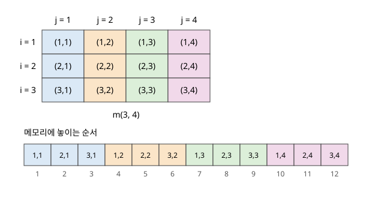

이 장에서는 같은 타입의 값을 여러 개 담는 배열을 배운다. 배열의 선언과 메모리에 놓이는 순서, 배열 전체 연산과 배열 부분, 배열을 다루는 내장 함수, 크기를 실행 중에 정하는 할당 가능 배열을 다룬다.

## 1차원 배열

`real :: a(20)`은 실수 20개를 담는 배열 `a`를 선언한다. 첨자(subscript)는 기본적으로 1부터 시작하므로 원소는 `a(1)`부터 `a(20)`까지다. 첨자의 범위를 `하한:상한`으로 직접 정할 수도 있다. `b(0:19)`는 `a`와 같은 크기이고 첨자가 0부터 19까지다. `weird(-162:237)`은 `237 - (-162) + 1`, 곧 400개의 원소를 가진다.

`size`, `lbound`, `ubound`, `shape`는 배열의 크기와 범위를 알려 준다.

<!-- file: ch10/declare_arrays.f90 -->
```fortran
program declare_arrays
  implicit none
  real :: a(20), b(0:19), weird(-162:237)
  real :: grid(0:2, -1:1)

  print '(a, i0)', 'size(a) = ', size(a)
  print '(a, i0, a, i0)', 'b runs from ', lbound(b, 1), ' to ', ubound(b, 1)
  print '(a, i0, a, i0, a, i0)', 'weird runs from ', lbound(weird, 1), &
    ' to ', ubound(weird, 1), ', size ', size(weird)
  print '(a, 2i3)', 'shape(grid) = ', shape(grid)
  print '(a, i0)', 'size(grid) = ', size(grid)
end program declare_arrays
```

<!-- output: ch10/declare_arrays.out -->
```text
size(a) = 20
b runs from 0 to 19
weird runs from -162 to 237, size 400
shape(grid) =   3  3
size(grid) = 9
```

배열의 원소 타입은 `integer`, `logical`, `double precision`을 포함해 어느 타입이든 된다. 원소 하나하나는 변수처럼 쓴다. 다음은 처음 10개의 제곱수를 배열에 넣는다.

<!-- file: ch10/squares.f90 -->
```fortran
program squares
  implicit none
  integer :: i
  integer :: sq(10)

  do i = 1, 10
    sq(i) = i**2
  end do
  print '(10i4)', sq
end program squares
```

<!-- output: ch10/squares.out -->
```text
   1   4   9  16  25  36  49  64  81 100
```

## 다차원 배열

`m(3, 4)`는 3행 4열 배열이다. 첫째 첨자가 행, 둘째 첨자가 열이다. 한 배열은 차원 수(rank)가 15까지 될 수 있다(Fortran 2018, 5.4.6). 차원마다 `하한:상한`을 따로 정할 수 있고, 전체 원소 수는 차원별 크기(extent)의 곱이다. 위 예제의 `grid(0:2, -1:1)`은 `3 x 3`이고, 배열의 형상(shape)은 크기를 모은 `[3, 3]`이다.

### 열 우선 순서

다차원 배열은 메모리에 한 줄로 놓인다. Fortran은 첫째 첨자가 가장 빨리 바뀌는 순서, 곧 열 우선 순서(column-major order)로 놓는다. 한 열의 원소가 연달아 놓이고 그다음 열이 이어진다.



표준은 이 순서를 배열 원소 순서(array element order)라 하고 위치를 식으로 정한다(9.5.3.2). 첨자 범위가 `j1:k1, j2:k2`인 2차원 배열에서 `(s1, s2)` 원소의 위치는 `1 + (s1 - j1) + (s2 - j2) * d1`이다. `d1`은 첫째 차원의 크기다. 첨자가 1부터 시작하는 `m(3, 4)`라면 `m(i, j)`는 `1 + (i - 1) + (j - 1) * 3`번째 원소다. 첫 원소에서 떨어진 거리를 원소 수로 세면 `(j - 1) * 3 + (i - 1)`이다. 원본의 `lda`는 이 식의 `d1`에 해당하며, 선언한 배열이 쓰는 행렬보다 클 때 둘이 달라지는 문제는 [15장](/fortran/15-arrays-in-subprograms/)에서 다룬다.

<!-- file: ch10/column_major.f90 -->
```fortran
program column_major
  implicit none
  integer :: i, j, pos
  integer :: m(3, 4), flat(12)

  do j = 1, 4
    do i = 1, 3
      m(i, j) = 10 * i + j
    end do
  end do
  do i = 1, 3
    print '(4i4)', m(i, :)
  end do

  flat = reshape(m, [12])
  print '(12i4)', flat

  i = 2
  j = 3
  pos = 1 + (i - 1) + (j - 1) * 3
  print '(a, i0, a, i0)', 'm(2, 3) = ', m(i, j), ', position ', pos
  print '(a, i0)', 'flat(pos) = ', flat(pos)
end program column_major
```

<!-- output: ch10/column_major.out -->
```text
  11  12  13  14
  21  22  23  24
  31  32  33  34
  11  21  31  12  22  32  13  23  33  14  24  34
m(2, 3) = 23, position 8
flat(pos) = 23
```

`reshape`로 만든 한 줄 배열은 `m`을 열 우선 순서로 편 것이고, 식으로 구한 위치 8의 값 `23`이 `m(2, 3)`과 같다. `print`가 2차원 배열을 통째로 받으면 이 순서로 출력하므로, 행 단위로 보려면 `m(i, :)`로 한 행씩 출력한다.

열 우선 순서를 알면 반복문의 순서를 정할 수 있다. 메모리 순서대로 읽도록 바깥 반복문이 열을, 안쪽 반복문이 행을 따라가게 쓴다. 위 예제의 `do j` 안에 `do i`를 둔 구조가 그렇다.

## 배열 생성자

배열 값을 한 번에 적으려면 배열 생성자(array constructor) `[ ... ]`를 쓴다. 값 목록 자리에는 암시적 do(implied do) `(식, 변수 = 시작, 끝, 증분)`을 쓸 수 있다. 암시적 do는 [9장](/fortran/09-loops/)의 `do`와 같은 규칙으로 값을 하나씩 만들어 낸다.

<!-- file: ch10/constructors.f90 -->
```fortran
program constructors
  implicit none
  integer :: i, j
  integer :: a(5), b(5), c(3, 2)
  real :: r(3)

  a = [1, 2, 3, 4, 5]
  b = [(i * i, i = 1, 5)]
  r = [real :: 1, 2, 3]
  c = reshape([((10 * i + j, i = 1, 3), j = 1, 2)], [3, 2])
  print '(5i4)', a
  print '(5i4)', b
  print '(3f5.1)', r
  print '(a, 6i4)', 'in memory order:', c
  print '(a, 5i4)', 'odd numbers:', [(i, i = 1, 9, 2)]
end program constructors
```

<!-- output: ch10/constructors.out -->
```text
   1   2   3   4   5
   1   4   9  16  25
  1.0  2.0  3.0
in memory order:  11  21  31  12  22  32
odd numbers:   1   3   5   7   9
```

생성자는 1차원 배열만 만든다. 2차원 배열은 `reshape(원천, 형상)`으로 모양을 잡는다. 이때 원천을 열 우선 순서로 채운다. 위 예제의 `c`는 암시적 do가 중첩되어 안쪽 `i`가 먼저 바뀌므로 `11, 21, 31, 12, ...` 순서의 값을 만든다.

생성자 안의 값은 타입이 모두 같아야 한다. `[1, 2.5]`는 정수와 실수가 섞여 있어 표준에 어긋난다(C7110). 타입을 직접 정하려면 `[real :: 1, 2, 3]`처럼 쓴다.

## 배열 전체 연산

배열 이름만 쓴 식은 모든 원소에 같은 연산을 한다. 이를 배열 전체 연산(whole-array operation)이라 한다. 크기와 형상이 같은 배열끼리는 같은 위치의 원소끼리 계산하고, 스칼라는 모든 원소에 적용한다.

<!-- file: ch10/whole_array.f90 -->
```fortran
program whole_array
  implicit none
  integer :: a(5), b(5), c(5)

  a = [1, 2, 3, 4, 5]
  b = 2 * a
  c = a + b
  print '(5i4)', c
  c = c * c - 1
  print '(5i4)', c
  c = 0
  print '(5i4)', c
end program whole_array
```

<!-- output: ch10/whole_array.out -->
```text
   3   6   9  12  15
   8  35  80 143 224
   0   0   0   0   0
```

`b = 2 * a`는 `do` 없이 `b`의 모든 원소를 채운다. 표준은 대입의 오른쪽 식을 모두 계산한 것처럼 동작해야 한다고 정한다(10.2.1.3). 그래서 `a(2:5) = a(1:4)`처럼 왼쪽과 오른쪽이 겹쳐도 오른쪽 값이 먼저 전부 정해진 뒤에 대입된다. 형상이 서로 다른 배열을 대입하거나 연산하면 컴파일러가 알 수 있는 경우 컴파일 오류다. 예를 들어 3개짜리 배열을 4개짜리 배열에 대입하면 gfortran 15.2는 `Error: Different shape for array assignment at (1) on dimension 1 (4 and 3)`을 낸다.

## 배열 부분

`a(2:5)`처럼 `하한:상한`으로 배열의 일부를 가리키는 것을 배열 부분(array section)이라 한다. 배열 부분도 배열이므로 배열 전체 연산에 쓰고 대입의 왼쪽에도 쓴다.

- `a(2:5)`는 2번부터 5번까지다. 하한을 생략하면 배열의 처음부터, 상한을 생략하면 끝까지다.
- `a(::2)`처럼 셋째 값이 보폭(stride)이다. 음수이면 거꾸로 간다.
- `m(:, 2)`는 2열 전체, `m(2, :)`는 2행 전체다. 첨자 하나를 정수로 고정하면 차원 수가 하나 준다.
- `m(1:2, 3:4)`처럼 차원마다 범위를 쓸 수 있다.

<!-- file: ch10/sections.f90 -->
```fortran
program sections
  implicit none
  integer :: i
  integer :: a(8), m(3, 4)

  a = [(10 * i, i = 1, 8)]
  m = reshape([(i, i = 1, 12)], [3, 4])

  print '(a, 4i4)', 'a(2:5)   =', a(2:5)
  print '(a, 3i4)', 'a(:3)    =', a(:3)
  print '(a, 3i4)', 'a(6:)    =', a(6:)
  print '(a, 4i4)', 'a(::2)   =', a(::2)
  print '(a, 4i4)', 'a(8:5:-1)=', a(8:5:-1)
  print '(a, 3i4)', 'm(:, 2)  =', m(:, 2)
  print '(a, 4i4)', 'm(2, :)  =', m(2, :)
  print '(a, 4i4)', 'm(1:2, 3:4) =', m(1:2, 3:4)

  a(2:4) = 0
  print '(a, 8i4)', 'a =', a
end program sections
```

<!-- output: ch10/sections.out -->
```text
a(2:5)   =  20  30  40  50
a(:3)    =  10  20  30
a(6:)    =  60  70  80
a(::2)   =  10  30  50  70
a(8:5:-1)=  80  70  60  50
m(:, 2)  =   4   5   6
m(2, :)  =   2   5   8  11
m(1:2, 3:4) =   7   8  10  11
a =  10   0   0   0  50  60  70  80
```

`m(1:2, 3:4)`처럼 2차원 부분을 `print`에 넘기면 열 우선 순서로 `7 8 10 11`이 출력된다.

## 배열을 다루는 내장 함수

배열을 다루는 내장 함수가 많다. 자주 쓰는 것은 다음과 같다.

| 함수 | 결과 |
|---|---|
| `size(a)` | 원소 수. `size(a, dim)`은 해당 차원의 크기 |
| `shape(a)` | 형상 (각 차원의 크기를 모은 배열) |
| `lbound(a)`, `ubound(a)` | 첨자의 하한, 상한 |
| `sum(a)`, `product(a)` | 모든 원소의 합, 곱 |
| `maxval(a)`, `minval(a)` | 최댓값, 최솟값 |
| `maxloc(a)` | 최댓값의 위치. 같은 값이 여럿이면 첫 위치 |
| `any(m)`, `all(m)` | 논리 배열 `m`의 원소가 하나라도, 모두 참인가 |
| `count(m)` | 참인 원소 수 |
| `reshape(원천, 형상)` | 원천을 다른 형상으로 재배열 |
| `transpose(a)` | 전치 |
| `matmul(a, b)` | 행렬곱 |
| `dot_product(v, w)` | 벡터의 내적 |

`maxloc`은 기본적으로 위치를 담은 1차원 배열을 돌려준다. 1차원 배열에서 스칼라 위치가 필요하면 `dim=1`을 준다. `any`, `all`, `count`의 인수는 보통 `x > 2`처럼 배열에 대한 관계식이다.

<!-- file: ch10/reductions.f90 -->
```fortran
program reductions
  implicit none
  integer :: x(8)

  x = [3, 1, 4, 1, 5, 9, 2, 6]
  print '(a, i0)', 'sum     = ', sum(x)
  print '(a, i0)', 'product = ', product(x)
  print '(a, i0)', 'maxval  = ', maxval(x)
  print '(a, i0)', 'minval  = ', minval(x)
  print '(a, i0)', 'maxloc  = ', maxloc(x, dim=1)
  print '(a, l1)', 'any(x > 8)  = ', any(x > 8)
  print '(a, l1)', 'all(x > 0)  = ', all(x > 0)
  print '(a, i0)', 'count(x > 2) = ', count(x > 2)
end program reductions
```

<!-- output: ch10/reductions.out -->
```text
sum     = 31
product = 6480
maxval  = 9
minval  = 1
maxloc  = 6
any(x > 8)  = T
all(x > 0)  = T
count(x > 2) = 5
```

`matmul`과 `transpose`, `dot_product`는 다음과 같이 쓴다. `a`는 `reshape`가 열 우선 순서로 채우므로 첫 행이 `1 3 5`다.

<!-- file: ch10/matrix_ops.f90 -->
```fortran
program matrix_ops
  implicit none
  integer :: i
  integer :: a(2, 3), b(3, 2), c(2, 2), v(3), w(3)

  a = reshape([1, 2, 3, 4, 5, 6], [2, 3])
  b = transpose(a)
  c = matmul(a, b)
  v = [1, 2, 3]
  w = [4, 5, 6]

  do i = 1, 2
    print '(a, 3i3)', 'a row:', a(i, :)
  end do
  do i = 1, 3
    print '(a, 2i3)', 'b row:', b(i, :)
  end do
  do i = 1, 2
    print '(a, 2i4)', 'c row:', c(i, :)
  end do
  print '(a, i0)', 'dot_product(v, w) = ', dot_product(v, w)
end program matrix_ops
```

<!-- output: ch10/matrix_ops.out -->
```text
a row:  1  3  5
a row:  2  4  6
b row:  1  2
b row:  3  4
b row:  5  6
c row:  35  44
c row:  44  56
dot_product(v, w) = 32
```

## where

배열의 일부 원소에만 연산을 적용하려면 `where`를 쓴다. 조건은 배열 논리식이고, 참인 위치에만 대입한다. 한 줄 `where (조건) 대입`과 `where`, `elsewhere`, `end where` 구문이 있다.

<!-- file: ch10/where_demo.f90 -->
```fortran
program where_demo
  implicit none
  real :: a(6), b(6)

  a = [-2.0, 3.0, 0.0, -1.0, 5.0, 4.0]
  where (a < 0.0) a = 0.0
  print '(6f6.1)', a

  where (a > 0.0)
    b = 1.0 / a
  elsewhere
    b = -1.0
  end where
  print '(6f6.2)', b
end program where_demo
```

<!-- output: ch10/where_demo.out -->
```text
   0.0   3.0   0.0   0.0   5.0   4.0
 -1.00  0.33 -1.00 -1.00  0.20  0.25
```

첫 `where`는 음수를 0으로 바꾼다. 둘째는 양수 위치에만 역수를 넣고, 나머지에는 `-1.0`을 넣는다. 표준은 원소별 연산을 조건이 참인 원소에서만 수행한다고 정하므로(10.2.3.2) 조건이 거짓인 위치에서는 0으로 나누지 않는다.

## 할당 가능 배열

배열의 크기를 실행하기 전에 모를 때는 `allocatable` 속성으로 선언하고 크기는 `(:)`로 비워 둔다. 크기는 `allocate` 문이 정하고, 다 쓴 뒤에는 `deallocate`로 돌려준다. `allocated(a)`는 지금 할당되어 있는지 알려 준다. 프로그램이 시작할 때 할당 가능 변수는 할당되지 않은 상태다.

`allocate`에 `stat=` 변수를 주면 실패해도 프로그램이 멈추지 않고 그 변수가 0이 아닌 값이 된다. `stat=`이 없을 때 실패하면 오류 종료한다. 이미 할당된 변수를 다시 `allocate`하는 것도 실패다(9.7.1).

배열에 대입할 때는 크기를 맞춰 줄 필요가 없다. 할당 가능 배열의 형상이 오른쪽 식과 다르면 자동으로 새 형상으로 할당된다(10.2.1.3).

<!-- file: ch10/allocate_demo.f90 -->
```fortran
program allocate_demo
  implicit none
  integer :: i, n, ios
  integer, allocatable :: a(:)

  n = 4
  print '(a, l1)', 'allocated before: ', allocated(a)
  allocate (a(n))
  a = [(i, i = 1, n)]
  print '(a, l1, a, i0)', 'allocated now: ', allocated(a), ', size ', size(a)

  allocate (a(n), stat=ios)
  if (ios /= 0) print '(a)', 'second allocate failed'

  a = [10, 20, 30, 40, 50, 60]
  print '(a, i0)', 'size after assignment: ', size(a)

  deallocate (a)
  print '(a, l1)', 'allocated after: ', allocated(a)
end program allocate_demo
```

<!-- output: ch10/allocate_demo.out -->
```text
allocated before: F
allocated now: T, size 4
second allocate failed
size after assignment: 6
allocated after: F
```

`a`는 4개짜리로 할당했지만 6개짜리 생성자를 대입하자 크기가 6이 되었다. 새로 할당된 배열의 하한은 오른쪽 식의 하한인 1이다.

## 범위를 벗어난 접근

선언한 범위 밖의 원소를 읽거나 쓰는 것은 표준을 어기는 오류다. 그러나 컴파일러와 프로그램은 기본적으로 이를 검사하지 않는다. 다음 프로그램은 5개짜리 `a`에 6번째 원소를 쓴다. 반복 횟수가 컴파일할 때 정해져 있으면 gfortran이 경고하므로 `n`을 입력으로 받는다.

<!-- file: ch10/out_of_bounds.f90 -->
```fortran
program out_of_bounds
  implicit none
  integer :: i, n
  integer :: a(5)

  read (*, *) n
  do i = 1, n
    a(i) = i
  end do
  print '(a, i0)', 'filled ', n
end program out_of_bounds
```

`6`을 입력하고 `-std=f2018 -Wall -Wextra`로 컴파일해 실행하면 gfortran 15.2는 아무 오류 없이 끝나고 `filled 6`을 출력한다. 범위를 넘어선 쓰기가 다른 변수를 덮어쓰고 있을 수도 있고, 이런 오류는 엉뚱한 곳에서 이상한 결과로 나타난다. `-fcheck=bounds` 옵션을 주면 실행 중에 검사해 멈춘다. 다음은 gfortran 15.2의 메시지다.

```text
At line 8 of file out_of_bounds.f90
Fortran runtime error: Index '6' of dimension 1 of array 'a' above upper bound of 5
```

런타임 검사는 [19장](/fortran/19-debugging/)에서 자세히 다룬다.

## dimension 문

옛 코드에서는 배열을 `dimension` 문으로 선언한 것을 볼 수 있다. 다음 선언은 `real :: x(50), m(10, 20)`과 같은 뜻이다. 새 코드에서는 `real :: x(50)`처럼 선언문에 바로 쓴다.

<!-- file: ch10/dimension_stmt.f90 -->
```fortran
program dimension_stmt
  implicit none
  real :: x
  real :: m
  dimension x(50), m(10, 20)

  x(1) = 1.0
  m(1, 1) = 2.0
  print '(a, i0, a, i0)', 'sizes: ', size(x), ' and ', size(m)
end program dimension_stmt
```

## 흔한 실수

- 첨자가 범위를 벗어나는데 컴파일러가 알려 주지 않는다. 의심되면 `-fcheck=bounds`로 다시 실행한다.
- 선언만 한 배열을 0으로 초기화되어 있다고 가정한다. 값을 대입하기 전의 원소는 정해지지 않은 값이다.
- 2차원 배열을 행 우선으로 생각해 `reshape`의 결과를 거꾸로 이해한다. `reshape([1, 2, 3, 4, 5, 6], [2, 3])`의 첫 행은 `1 3 5`다.
- 배열 생성자에 정수와 실수를 섞는다. 타입을 `[real :: ...]`로 정하거나 값의 타입을 맞춘다.
- 할당된 배열에 `allocate`를 또 한다. `allocated`로 확인하거나, 대입으로 자동 재할당한다.
